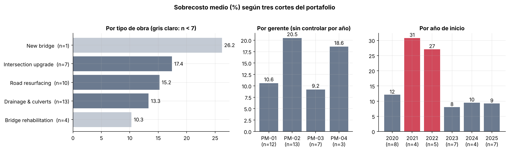
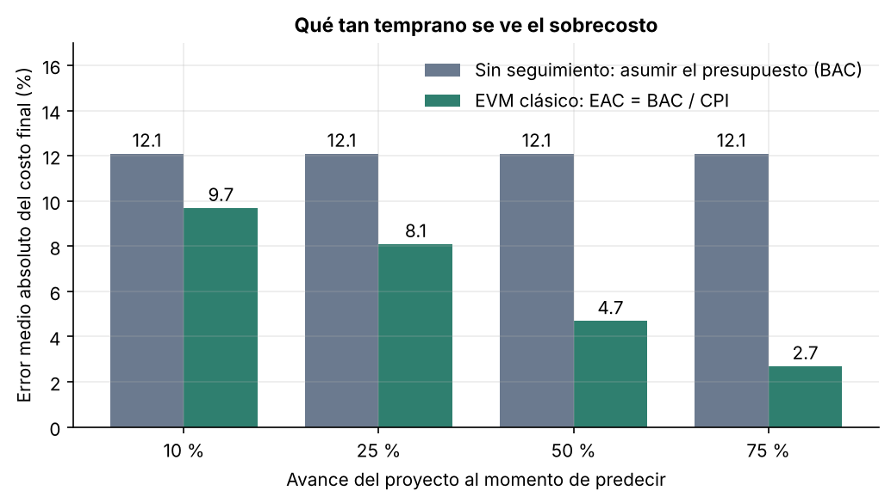
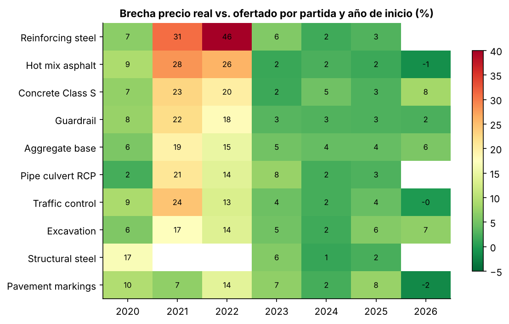

# Ridgeline Infrastructure Analytics

**Predictive cost & schedule analytics for a civil construction contractor — an end-to-end data science case study.**

> **Note:** Ridgeline Infrastructure Co., its projects, and clients serve as an illustrative case study. All datasets in this repository are **synthetic**, generated via [`src/generate_data.py`](src/generate_data.py) with a fixed random seed for full reproducibility. No proprietary data from real employers or clients is used.

## The scenario

Ridgeline Infrastructure Co. is a heavy-civil contractor building roads and bridges across TX, LA, OK and AR. Management learns about cost overruns and schedule slippage only when it is too late, bids have been underpriced during inflationary years, and equipment breaks down without warning. There is no unified view of cost, schedule and fleet health.

| | |
|---|---|
| Portfolio | 38 projects, 2020–2026 (35 completed, 3 active) |
| Project types | Road resurfacing, bridge rehabilitation, new bridges, drainage & culverts, intersection upgrades |
| Contract size | USD 1.5M – 60M |
| Fleet | 24 machines with daily telemetry |

## Services demonstrated

1. **Predictive cost & schedule control (anchor service)** — Earned Value Management (CPI, SPI), estimate-at-completion forecasts and early-warning alerts.
2. **Unit-price & bid analytics** — gap between bid and actual unit prices by line item and year, to flag underpriced work before bidding.
3. **Equipment productivity & health** — idle-time and fuel analysis, plus detection of degradation patterns that precede breakdowns.

## Key findings

Full analysis, with code and charts: [`notebooks/01_eda_evm.ipynb`](notebooks/01_eda_evm.ipynb).

| # | Finding | Confidence |
|---|---|---|
| 1 | Projects started in **2021–22 finished ~29 % over budget** (vs. ~10 % otherwise); **material prices explain ~58 %** of the portfolio's total overrun | High |
| 2 | **CPI at 25 % progress** flags problem projects early; classic EVM cuts forecast error from 12 % to 8 % (at 25 %) and 3 % (at 75 %) | Medium |
| 3 | 2 of 3 active projects are in **red alert** — one for cost (P015, ≈ USD 7.6 M projected overrun), one for schedule (P007) | High |
| 4 | Three machines idle **52 %** of engine hours vs. 22 % for the fleet (~3,700 excess hours) | High |
| 5 | Equipment failures show rising vibration and temperature **9–14 days ahead** | Low (only 5 events) |

Some questions the data cannot answer yet — for example, whether bridges overrun more than other work types (only 5 bridge projects) — are flagged as inconclusive rather than forced into a conclusion.







## Repository structure

```
├── data/          Synthetic datasets (CSV)
├── src/           Data generator and reusable code
├── notebooks/     Exploratory analysis and modeling
├── app/           Streamlit dashboard
├── docs/          Data dictionary, findings, executive report
└── requirements.txt
```

## Data

| File | Rows | Description |
|---|---|---|
| `projects.csv` | 38 | Project master: type, status, PM, contract value, budget at completion (BAC), dates, final cost, change-order total |
| `bid_items.csv` | 230 | Line items per project: bid vs. actual quantity and unit price |
| `weekly_evm.csv` | 1,568 | Weekly series per project: planned value, earned value, actual cost, rain days |
| `change_orders.csv` | 86 | Change orders with date, amount and reason |
| `equipment_telemetry.csv` | 13,482 | Daily per machine: engine/idle hours, fuel, temperature, vibration, fault codes |
| `equipment_failures.csv` | 5 | Unplanned failures with downtime |

Column-level details: [`docs/data_dictionary.md`](docs/data_dictionary.md).

## Quick start

```bash
git clone https://github.com/ferserna95/ridgeline-infrastructure-analytics.git
cd ridgeline-infrastructure-analytics
pip install -r requirements.txt
python src/generate_data.py      # regenerates data/ (optional, CSVs are included)
```

## Roadmap

- [x] Business case scenario and synthetic dataset
- [x] Repository structure and documentation
- [x] Exploratory data analysis and EVM metrics ([notebook](notebooks/01_eda_evm.ipynb))
- [ ] Predictive model for cost overrun and schedule delay
- [ ] Unit-price and bid-risk model
- [ ] Equipment predictive-maintenance model
- [ ] Interactive Streamlit dashboard with alerts
- [ ] Executive report for management

## Tech stack

Python · pandas · NumPy · Matplotlib · scikit-learn · Streamlit

## About

Built by an electrical engineer and data scientist, as a demonstration of data science applied to civil construction. Open to remote consulting engagements.

## License

[MIT](LICENSE)
